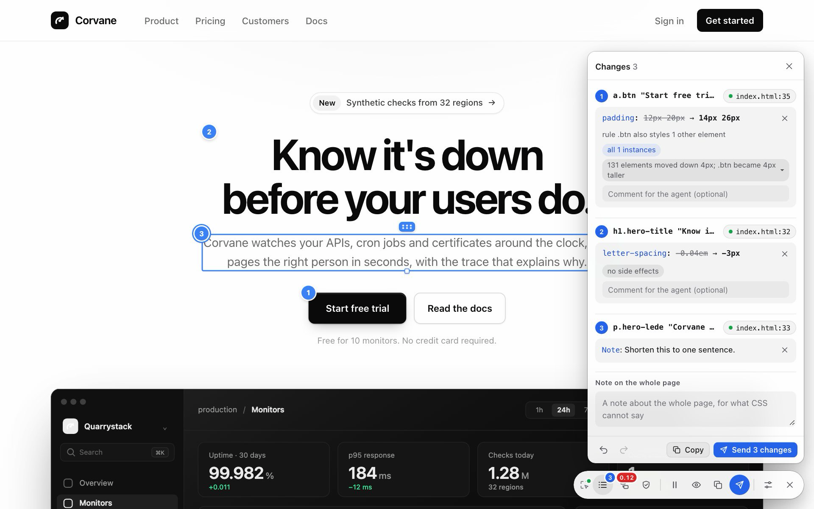
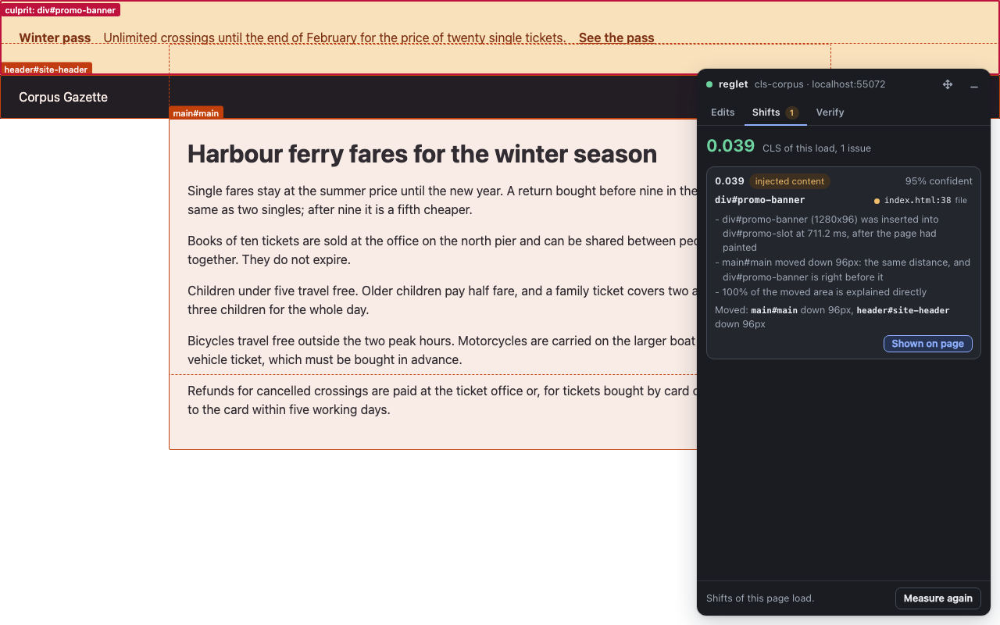

# primp

Edit your running app by hand, let your coding agent write the code, and have the result checked against the page.

**[Website and live demo](https://primp-dev.vercel.app)** · [Docs](https://primp-dev.vercel.app/docs/) · `npx @primpdev/cli demo`

primp is a proxy you run in front of your dev server. It adds a dock to your app with three jobs:

- **Edits.** Open the dock (its button in the corner, or Cmd/Ctrl+Shift+E), click any element, change any CSS property (at rest or for `:hover`, `:focus`, `:focus-visible` or `:active`), resize it by dragging its edge, move it among its siblings, hide or remove it, or leave a note in your own words for what CSS cannot say (new copy, "make this a link"). primp records what you changed, where the element lives in your source, and what else on the page moved because of it.
- **Shifts.** See the layout shifts of the page load: which element caused each one, why, and on which source line.
- **Verify.** After your agent (Claude Code, Cursor, Codex, any MCP client, or a pasted prompt) edits the source, primp re-measures the page and reports pass, drift or fail for every change, so the agent can correct itself.

primp never writes to your source files. Nothing is installed in your project.



> Status: 0.1, the first release. Built and tested on macOS with Chromium; see [What is tested](#what-is-tested).

## Try it

```sh
npx @primpdev/cli demo
```

This copies a one-page site with one seeded layout shift into `./primp-demo`, serves it, and opens it with the dock. The terminal tells you what to say to your agent.

## Use it on your project

Start your dev server as usual, then, in the project directory:

```sh
npx @primpdev/cli
```

primp finds the dev server, starts a proxy on the next port and opens your app through it. Useful options:

| Option | What it does |
|---|---|
| `--target <url or port>` | The dev server to sit in front of, when primp cannot find it or finds the wrong one |
| `--exec "<command>"` | Start the dev server too, and stop it on exit: `npx @primpdev/cli --exec "npm run dev"` |
| `--port <n>` | Port for the proxy |
| `--no-open` | Do not open the browser |
| `--quiet` | No activity lines after start-up (a tab attached, changes sent and taken, results) |

### Connect your agent

```sh
npx @primpdev/cli setup
```

This asks before running your client's own command (`claude mcp add ...`, `codex mcp add ...`) and prints the JSON for Cursor. It never edits a configuration file itself. Without MCP, the **Send** button copies the same instructions to your clipboard.

The agent gets seven tools:

| Tool | For |
|---|---|
| `get_session` | Is primp running, is a tab attached, is anything queued |
| `get_pending_changes` | Take the changes you sent, grouped by source file, with instructions |
| `wait_for_changes` | Wait for your next Send and take those changes: say "watch primp" once, then just press Send |
| `verify_changes` | Wait for the page to update, measure, and get pass / drift / fail per change |
| `get_layout_shifts` | The shifts of the last page load: culprit, cause, evidence, source line |
| `verify_layout_shift` | Reload the page three times without cache and report whether the shift came back |
| `dismiss_change` | Close a change that should not be made, with a reason |

## What makes it different

Several tools let you edit a live page and hand the changes to an agent. primp is built around what happens before and after that hand-off.

**Side effects.** Every edit is measured: "14 elements moved down 16px; the footer overflows". Mark one as unwanted and it becomes a constraint the agent must keep ("must not move: footer").

**Bystanders.** A change often gets implemented by editing a rule that other elements share. primp records up to three elements the same rule styles that you did not touch, tells the agent they must stay as they are, and fails the change if one of them moved: "`a.btn "See plans"` was not part of this change, but its `padding-top` went from 10px to 14px".

**States, order and size, checked too.** A `:hover` or `:focus` change is previewed and verified with the state emulated: you see the hover look while you edit without holding the mouse still, and the check reads the value in that state, not at rest. Moving an element among its siblings is verified by the order of the elements in the page, and the agent is told to reorder the data when the elements come from a list. A resize is an ordinary width and height change, checked like any other.

**Layout shifts.** primp records the page load from its first script, attributes each shift to the element that caused it (an image without reserved space, a web font swapping in, content inserted above other content), and resolves that element to a line in your source.



**Verification that does not flatter.** A change only passes when the page was measured and the value is there.

| What happened | What primp reports |
|---|---|
| The value is the one you asked for | `pass` |
| It landed close, such as the nearest design token | `drift` |
| It is something else, or unchanged | `fail`, with expected and actual |
| An element you did not touch changed with it | `fail`, naming that element |
| The build is broken | `build_error`, with the message |
| No source file changed | `no_update_observed` |
| The element cannot be found again | `unresolved` |
| The viewport is outside the change's media query, or the state cannot be emulated | `not_measurable` |
| The tab is in the background, or closed | `tab_hidden`, `no_browser` |
| The change is a note (free text such as a copy change), which nothing on the page can measure | `not_checkable`: you check it by eye |

The last four are never counted as success.

## What is tested

Each claim below has a script in `spikes/` that exits 0 or 1.

| | Vite + React 19 | Next 16 (Turbopack, RSC, strict CSP) | SvelteKit (Svelte 5) | Plain HTML |
|---|---|---|---|---|
| Proxy in front of it (hot reload, logins, streamed pages where the app has them) | yes | yes | yes | yes |
| Element to source line | exact | exact, server and client components | exact when hydrated | exact |
| Edit, hand off, verify loop | yes | yes | yes | yes (primp reloads the page) |

- **Other frameworks** (Vue, Astro, Solid, Angular, server-rendered templates): the proxy and the dock are framework-independent and should work; source positions fall back to ranked guesses. Untested.
- **Layout shifts** need Chromium, the only engine with the Layout Instability API. Resources from other origins never pass through the proxy, so their timing cannot be replayed cold.
- **Browsers:** only Chromium has been run. **Systems:** only macOS has been run. On Windows, pass `--target`.
- **Attribution accuracy.** On 14 realistic pages written without sight of the attribution code and scored once (`fixtures/cls-heldout-2`, `pnpm spike:m4-heldout2`): the cause and culprit were named correctly, with confidence, on 7 of 10 pages that shift; the other 3 were reported as "unknown" without a confident claim; no page was given a confident wrong answer; none of the 4 pages that must not be accused was. The goal was 8 of 10. An earlier blind set scored 5 of 11 and led to three fixes, after which it scores 11 of 11, which is no longer a measurement.

## Known limits

- Because the proxy listens on its own port, logins kept in `localStorage` and OAuth redirect URLs tied to the dev server's port do not carry over.
- Every response through primp is sent uncached, so each load is a first visit. That is deliberate (it is the load whose layout shifts matter, and an edit is never hidden by a stale stylesheet), but pages load a little slower than straight from the dev server.
- A dev server's shifts can differ from production. Point primp at `vite preview` or `next start` to check; source positions are then less precise.
- If your app opens a modal `<dialog>`, the dock cannot be used until it closes.
- Reordering moves an element among the children of its parent only, never into another parent.
- Resize has right, bottom and corner handles; there are none on the left and top edges.
- `:hover` and focus changes are verified by emulating the state from the page's readable stylesheets. Behaviour made by script (a class added on mouse-over) and rules in stylesheets from another origin cannot be checked: such a change is reported as `fail` or `not_measurable`, never as a pass.
- State changes do not get the bystander check: other elements that share the rule are not recorded for them.
- A preview cannot override an author `!important` of higher specificity.

## Privacy

primp runs on your machine and talks only to your dev server and your browser. It has no telemetry and makes no network requests of its own. The proxy accepts connections from `localhost` only.

## Repository

```
packages/protocol   schemas shared by browser and server
packages/engine     pure logic: side effects, shift attribution, prompts, the pass/drift/fail judge
packages/source     element to file:line
packages/server     proxy, settle detection, session, verification, MCP control
packages/overlay    the injected hook and the dock
packages/cli        the published `primp` binary
fixtures/           apps the checks run against
spikes/             end-to-end checks; `pnpm spike:<name>`
site/               the website: a static Next.js export, with primp's dock running on every page
```

```sh
pnpm install
pnpm test          # unit tests
pnpm typecheck
pnpm spike:m3-loop # the edit / hand-off / verify loop on four fixtures
pnpm build         # packages/cli/dist
```

Fixtures have their own installs: `pnpm install --ignore-workspace` inside each `fixtures/*` directory.

### The website

`site/` is a Next.js app (App Router, static export, Tailwind, MDX docs) with its own install, like a fixture. primp's real dock and head script run on every page, with an in-browser stand-in for primp's server (`site/tools/standin`): the prompt and the layout-shift attribution are primp's own code, the source lookup is primp's text search over the site's sources, and nothing is verified (there is no agent).

```sh
pnpm site:assets                                  # the dock, head script and stand-in into site/public/primp
cd site && pnpm install --ignore-workspace && pnpm build   # site/out, plain files for any static host
pnpm exec tsx site/serve.ts                       # serve site/out locally
pnpm spike:site                                   # build and check: pages, links, CLS 0, the live dock
pnpm site:capture                                 # new screenshots and facts from a real run on the demo site
```

The repository and site URLs are set in `site/lib/config.ts`.

## Licence

MIT. See `CONTRIBUTING.md` for the clean-room rule and `NOTICE` for code adapted from other MIT projects.
